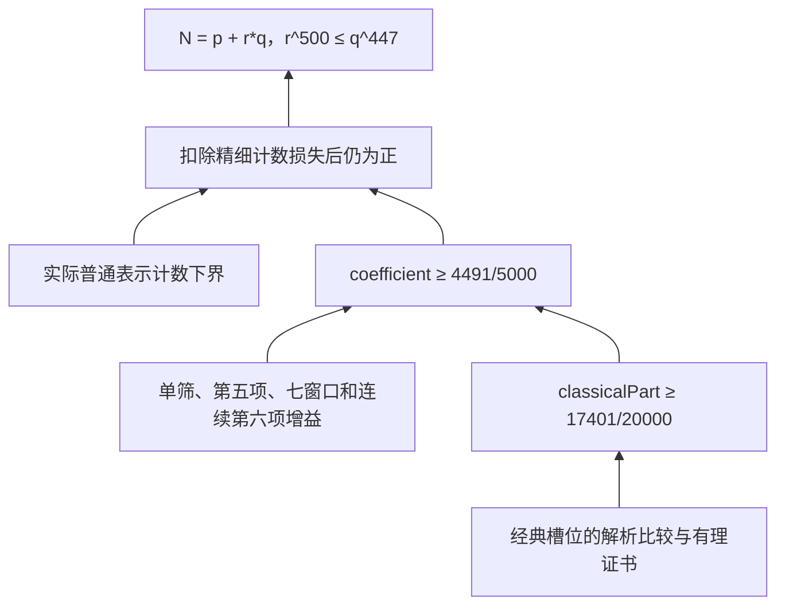

# Wu04／Wu08：1+1.894 的形式化

本目录沿 Wu04／Wu08 双筛路线推出 **1+1.894**，并提供独立的源码清单、构建和验收入口。最终证明位于 `src/WR2ClassicalCertificate.lean`，公开无条件定理 `WuPaper.ClassicalSlots.one894`。集成后的 **8826 模块全量源码构建、独立字面命题与公理检查、最终模块内核复核均已通过**。本轮最终公开验收采用 1+1.894 的自然数幂命题，内部精细计数载体的参数及其转换见下文。

源码规模与精简统计见[统一统计说明](../../docs/SOURCE_SIZE.md)及本目录的 `source-size-report.json`。最终定理的本地导入闭包为 8444 个模块、1,126,636 行有效代码、1,257,657 行物理行；完整构建范围为 8826 个模块。统计包含生成的数值证书，不包含外部 Mathlib 等 Lake 依赖，也不表示最小声明级证明长度。

## 布局

- `src/`：从实际编译对象导入图恢复的源码，以及新增的解析比较与数值证书。顶层 `Wu2008Research` 联合导入本轮原文路线的交付入口。
- `source-manifest.json`：模块、源码 SHA-256、原对象指纹及导入关系。`matching_source_variants` 大于一表示存在多个同导入表源码版本；这不是源与对象等价已经证实的标志，必须经过重建及接口检查。
- `roots.json`：原文路线默认入口，以及其他已编译研究入口。后者含较早替代路线，不能用于宣称原文路线已经闭合。
- `history/`、`history-manifest.json`：69个旧工作树中的源码按内容去重保存。4127条原相对路径记录对应1292份不同源码；包括失败尝试和诊断程序。**历史目录不参与默认构建，不保证每个历史版本都能编译。** 初次搜集的3个未选中依赖候选另保存在 `history/initial-source-candidates/`。
- `mathematical-status.json`：最终验收记录，以及各阶段证明、数值证书和历史验收状态；当前完整结果以 `final_acceptance` 为准。
- `build.py`：仅使用本目录源码、固定工具链及固定 Lake 依赖重建。不会加载旧服务器的研究对象路径。

## 复现

工具链及依赖版本固定于 `lean-toolchain`、`lakefile.toml`、`lake-manifest.json`。在本目录执行：

```sh
lake update
lake exe cache get
lake build Architect
python3 verify_sources.py
python3 build.py
```

`lake update` 后应确认依赖 revision 仍与提交的清单一致；不要以更新工具链来规避错误。数学库缓存可以复用，研究证明对象必须由本目录源码产生。详细构建命令和成功／失败回执保存在未纳入 Git 的 `build/` 中。

```sh
# 检查额外研究入口；不编译 history 中的失败或旧变体
python3 build.py --all
```

可先验证完整构建范围中的关键模块，再继续其余模块；`--first` 可重复，且不会缩小 `--root` 或 `--all` 选定的范围：

```sh
python3 build.py --first MathlibNt.Wu2008DoubleSieve.FourthRowGamma5Paid
```

构建期间若源码、依赖对象或源码清单发生变化，脚本以 `inputs_changed`（退出码125）停止，避免将新源码绑定到旧导入图；更新清单后重新执行即可。

构建可中断并继续；仅在源码、依赖对象及输出指纹均一致时复用成功回执。超时、失败和完整成功分别记录，不能把一次分批退出0解释为全量通过。

可用 `--jobs` 并行编译依赖已验证的独立模块；默认值为 1，保持串行构建。`--lean-threads` 控制每个 Lean 进程的线程数，默认值为 2。例如：

```sh
python3 build.py --all --jobs 4 --lean-threads 2
```

并行模式保留相同的源码和依赖哈希检查。`--first` 决定就绪模块的优先级；`--limit` 限制本次实际启动的编译数，缓存命中不计入限额。失败后不再派发新模块，已启动的独立任务结束并保存各自回执，失败模块的下游不会启动。最终通过仍要求选定范围内全部模块验证成功。

## 数学范围

- 七个固定高素数窗已接入原始实际计数：四个 Ψ₁ 窗及三个 Ψ₂ 窗均支付发表系数。Ψ₂ 的完整 Γ 项使用同一实际参数下的耦合核上确界，不以独立上确界之和替代。
- 修正后的实际九行系统、81 项候选矩阵下界和共用 σ 积分下界已通过检查；候选表已运输到原始 H/h 节点。
- `WR2XiSourceRoot` 联合公开完整实际计数总账及三个有理增益下界：单筛 `23732/10^6`、第五项 `1297/10^6`、七窗口 `31029/10^6`。共用延拓节点及有限转移表避免重复支付。最终无条件入口是 `WR2ClassicalCertificate`。
- `WR2XiSixthCertificate` 已证明连续第六项增益 `SourceSixth.amount ≥ 283/5000`，使用实际四分之一截断区域的精确积分化简和 1024 个有理区间证书。`SixthContinuous.one894_of_classical` 将原始经典总量下界 `classicalPart ≥ 17401/20000` 转为目标结论。新增经典证书已证明该界并推出无条件 `ClassicalSlots.one894`；集成后的完整构建及最终验收均已通过。
- 一般母式、域差额和旧替代路线的条件接口仍按各自定理类型保留，不能用固定七窗的结果宣称所有历史研究接口均已闭合。

整合新增证明后的主目录 3879 模块全量重建已通过（`build/full-rebuild-seven-source.log` 中的 `BUILD_PASS 3879`）。第六项证明已通过 3521 模块的暂存依赖闭包检查并整合进主目录；新增后的 3961 模块全量构建已通过（`build/full-rebuild-sixth-source.log` 中的 `BUILD_PASS 3961`）。

经典槽位证书在通过暂存审计后已并入研究树，集成后的 8826 模块全量重建已通过（`build/full-rebuild-classical-source.log` 中的 `BUILD_PASS 8826`）。集成前，第一项下界 `14.90088` 已通过 3607 模块依赖闭包检查，第八项上界 `5.27960` 已通过 3418 模块完整依赖审计。条件接口 `ClassicalSlots.one894_of_three_slots` 已通过 4495 模块完整依赖审计，说明以下三个界足以推出最终结论：

| 经典槽位 | 所需有理界 | 暂存验证进度 |
| --- | --- | --- |
| 第四项 | 上界 `19.64373` | 最终证书及完整依赖闭包 5588 个模块通过；源码、对象和依赖哈希已核对 |
| 第五项 | 下界 `1.65533` | 最终证书及完整依赖闭包 3521 个模块通过 |
| 第六项 | 下界 `3.81909` | 最终证书及全部 1029 个生成模块已通过暂存完整依赖审计 |

集成前，最终经典证书的 8443 模块依赖闭包已通过完整审计；另已独立核对所有源码、对象、导入清单和依赖哈希，以及全部 9205 个锁定输入。集成后的独立验收再次核对全部 8826 个模块的源码、对象和依赖收据，并通过字面命题与标准公理检查。无条件定理 `ClassicalSlots.one894` 和经典总量下界均仅依赖 `propext`、`Classical.choice`、`Quot.sound`。最终模块在重建的导入环境上通过独立内核复核。当前机器上的完整回执保存在 `build/classical-acceptance.json`、`build/integrated-acceptance.json`、`build/classical-literal-axioms.log` 和 `build/classical-kernel-replay.log`；源码指纹和阶段记录见 `mathematical-status.json`。

公开已验收定理的标准逻辑公理检查仅允许 `propext`、`Classical.choice`、`Quot.sound`；这与定理类型中明确写出的数学条件是不同层次。历史变体、导入目录或源文件数量都不代表全局数学完成。

## 从双筛计数到 1+1.894 的源码链

以下是最终证明实际使用的数学链；表中的文件可从结论向前阅读。

| 步骤 | 源码与接口 | 在最终证明中的作用 |
| --- | --- | --- |
| 无条件结论 | [WR2ClassicalCertificate.lean](src/WR2ClassicalCertificate.lean)：`ClassicalSlots.one894` | 将已证明的经典总量界交给第六项证书的结论接口 |
| 经典总量 | [WR2ClassicalSlotBudget.lean](src/WR2ClassicalSlotBudget.lean)：`classical_lower_of_slots`；[WR2ClassicalKnownSlots.lean](src/WR2ClassicalKnownSlots.lean) | 合并各槽位的有理上下界，支付第十、十一项成本；第三项由第四项控制，得到 `classicalPart ≥ 17401/20000` |
| 连续第六项增益 | [WR2XiSixthCertificate.lean](src/WR2XiSixthCertificate.lean)：`sixth_gain_lower` | 1024 个区间证书合并为 `SourceSixth.amount ≥ 283/5000` |
| 精确系数总账 | [WR2XiSourceFinalBudget.lean](src/WR2XiSourceFinalBudget.lean)：`coefficient_split`、`target_of_integral_bounds` | 经典总量加四项增益的四分之一，得到 `coefficient ≥ 4491/5000` |
| 实际表示计数 | [WR2XiSourceContinuousCount.lean](src/WR2XiSourceContinuousCount.lean)：`ordinary_count` | 对任意正误差 `ε`，给出充分大偶数的实际表示数量下界 `(coefficient − ε) * M N` |
| 精细计数损失 | [WRefinedCountBridge.lean](src/WRefinedCountBridge.lean)：`from_actual_count` | 扣除 `8 * log (5000/4469)` 及误差；严格正的余量使 `refinedGood N (9469/5000)` 非空 |
| 自然数幂结论 | [WR2XiSourceRefinedTarget.lean](src/WR2XiSourceRefinedTarget.lean)：`one894_of_coefficient`；[RefinedCounting.lean](src/MathlibNt/Wu2004MeanValue/RefinedCounting.lean) | 使用精细计数集合的单调性转到 `947/500`，由 `one894_power_iff` 得到精确条件 `r^500 ≤ q^447` |

这里 `M N` 是源码中的 `U8CanonicalMother.M N`，在所用阈值后严格为正。系数拆分中的四项增益下界依次是单筛 `23732/10^6`、第五项 `1297/10^6`、七窗口 `31029/10^6` 和连续第六项 `283/5000`。它们与经典总量界合并给出 `1796429/2000000 ≥ 4491/5000`，整个比较由 Lean 的有理运算核验。精细计数损失桥还包含 `N − 1` 为素数时的单位修正，使计数载体与原始表示集合一致。



`WR2XiSourceRoot` 等较早模块保留各自的条件接口；最终无条件入口是 `WR2ClassicalCertificate`。是否完成集成验收以全量构建、字面命题与公理检查、最终模块内核复核三项结果为准。

## 首列数值证书的生成

`diagnostics/xi2_rounded_certificates.py` 共用 `xi2_rectangle_candidate.py` 的九个原始分段公式。每个非空分段仍分成512个小区间，各项向下取整至分母 `10^12` 后相加。生成器输出36个分段等式和4个首列组装模块；每个等式由 Lean 的 `decide +kernel` 独立检查，分段编译可控制内存峰值。

```sh
# 仅输出四行、每行九个分段的整数分子
python3 diagnostics/xi2_rounded_certificates.py
# 与指定目录中的40份生成源码逐字比较，不修改源码
python3 diagnostics/xi2_rounded_certificates.py --check /path/to/certificates
```

`--write DIR` 可在指定目录重新生成源码。生成结果一致只证明可复现性；数学验收还需要下取整比较引理、解析积分比较、Γ₅预算及所有生成模块的内核检查。新增证书纳入 `src/` 时仍须更新源码清单并重建。

## 搬迁验收边界

本次先保存所有独有工作树源码，再恢复依赖。源码哈希及独立解包恢复检查与 Lean 全量重建分别验收；只有后者完成后才能称这个新布局的默认入口构建通过。旧工作树未删除，私人运行日志及机器路径对应表不进入本仓库。

历史搬迁记录对应当时的有限交付范围。当前 1+1.894 结论另由新增经典槽位证书闭合；其完整验收范围见上文，不以历史导入入口代替最终证明。

许可和来源归属沿用仓库根目录及各原文件的声明，包括原上游许可；本目录不是独立作者归属声明。

## 延拓节点数值证书的生成

`diagnostics/source_node_certificates.py` 用精确有理数生成第 11 至 29 个延拓节点的证书。每个原始基区间分成八段，对数弦线与倒数切线的乘积在整个区间下界原核；每项向下取整至分母 `10^12`，逐项由 Lean 核验后求和。四项对数展开的全局下界另有解析证明。

```sh
python3 diagnostics/source_node_certificates.py --check src
# 在新目录重新生成；不修改现有 src
python3 diagnostics/source_node_certificates.py --write /tmp/source-node-certificates
```

有限 h 转移表共用这些节点；整数求和用 `decide +kernel` 核验，再转为实数等式。最终单筛与第五项增益的证明复用同一份转移表。

第六项的 66 个生成源码可用 `python3 diagnostics/sixth_source_certificates.py --check src` 逐字节复现；`--write DIR` 可生成到独立目录。生成器只使用精确分数和向下取整，所有数值不等式仍由 Lean 核验。

## 经典第六项数值证书的生成

`diagnostics/classical_sixth_certificates.py` 使用精确有理数，在两段积分区间各取 4096 个中点，以十二项对数下界计算点值，再向下取整至分母 `10^12`。它生成 512 个点值模块、两个整数表、512 个分块覆盖模块、两个覆盖根及最终组装模块，共 1029 个模块；不依赖临时目录中的数据文件。

```sh
# 与已有证书源码逐字比较，不修改目标目录
python3 diagnostics/classical_sixth_certificates.py --check /path/to/certificates
# 在独立目录重新生成
python3 diagnostics/classical_sixth_certificates.py --write /tmp/classical-sixth-certificates
```

全部 1029 个生成模块及最终证书已加入本研究树的 `src/`，并通过集成后的全量构建及最终验收。生成器复现通过仅说明源码一致，不能代替 Lean 验证。

## 经典第五项数值证书的生成

`diagnostics/classical_fifth_certificates.py` 在三个积分区间各取 1024 个中点，使用精确有理数重新计算十二次修正多项式、对数下界及分母为 `10^12` 的下取整值。修正多项式由两次多项式乘法与积分产生，无需 SymPy、SciPy 或诊断 JSON。共生成 391 个模块：192 个点值模块、三个整数表、192 个分块覆盖模块、三个覆盖根和最终组装模块。

```sh
python3 diagnostics/classical_fifth_certificates.py --check /path/to/certificates
python3 diagnostics/classical_fifth_certificates.py --write /tmp/classical-fifth-certificates
```

第五项最终证书已通过 3521 模块的暂存完整依赖审计，生成源码现已加入研究树的 `src/`，并通过集成后的全量构建及最终验收。逐字复现检查与 Lean 证明检查分别验收。

## 经典第四项数值证书的生成

`diagnostics/classical_fourth_certificates.py` 从步长 `1/4000` 和分母 `10^15` 重新计算 B、C、D 及外层积分表。所有运算均使用精确有理数，每步包含相应的梯形求积误差并向上取整，不依赖临时 JSON 或第三方 Python 包。

生成结果共 2481 个模块，包括六张整数表、36701 个自然数不等式、10541 个对数点值不等式及其分块覆盖证明。最终第四项组装文件及解析比较模块另行维护，不由此脚本生成。

```sh
python3 diagnostics/classical_fourth_certificates.py --check /path/to/certificates
python3 diagnostics/classical_fourth_certificates.py --write /tmp/classical-fourth-certificates
```

第四项最终证书已通过 5588 模块的暂存完整依赖审计，生成源码现已加入研究树的 `src/`，并通过集成后的全量构建及最终验收。生成器的检查与重新写出结果均逐字复现全部 2481 个模块；这种一致性只证明可复现性，不能代替完整依赖检查。

完成 `python3 build.py --all --jobs 4 --lean-threads 2` 后，运行 `python3 check_classical.py`。该验收先核对全部源码、对象和依赖收据，再独立检查字面命题 `∃ T ≥ 512, ∀ N ≥ T, Even N → ∃ p r q : ℕ, p.Prime ∧ (r = 1 ∨ r.Prime) ∧ q.Prime ∧ N = p + r*q ∧ r^500 ≤ q^447`，并拒绝非标准公理依赖。这两项验收及最终模块内核复核均已通过。

如需复现最终模块的独立内核复核，在本目录执行以下命令。它使用 `build.py` 记录的固定依赖路径及本次源码重建的对象：

```sh
python3 - <<'PY'
import json, os, subprocess
from pathlib import Path
root = Path.cwd()
plan = json.loads((root / 'build/PLAN.json').read_text())
env = os.environ.copy()
env.pop('LEAN_SRC_PATH', None)
env.pop('LEAN_PATH', None)
prefix = subprocess.check_output(
    ['lake', 'env', 'lean', '--print-prefix'], env=env, text=True).strip()
env['LEAN_PATH'] = ':'.join([str(root / 'build/lib'), *plan['package_paths']])
subprocess.run([str(Path(prefix) / 'bin/leanchecker'), '--verbose',
                'WR2ClassicalCertificate'], env=env, check=True)
PY
```
